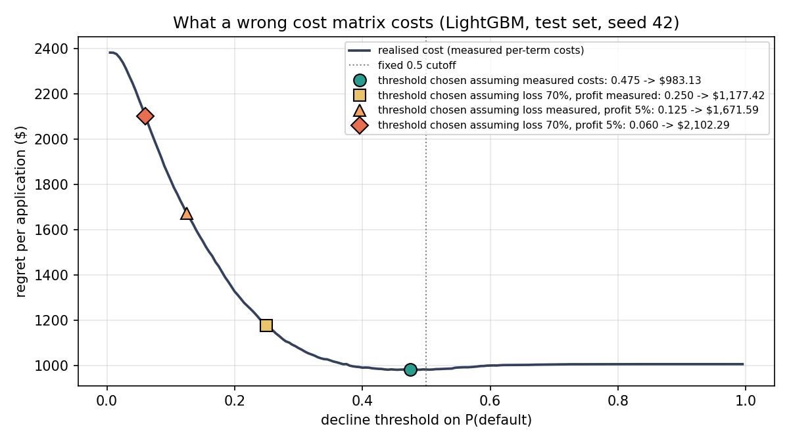
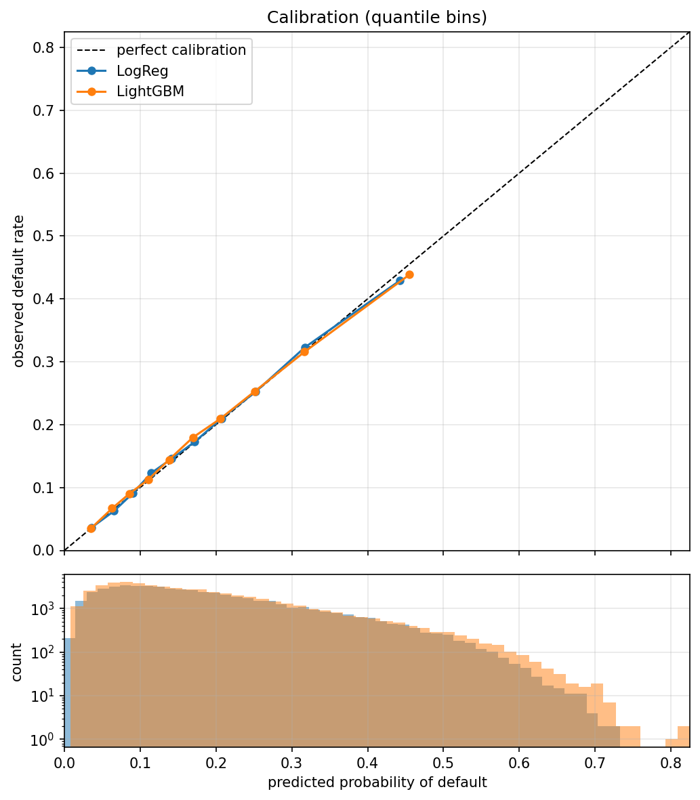

# Credit Default Risk as a Cost-Sensitive Decision

A LendingClub default model where the object of study is the **decision**, not the
classifier. A platform investor sees a loan LendingClub has already graded and priced,
and chooses to fund or decline it. The question: what improves that decision more —
a better model, or a correctly measured cost of being wrong?

**Answer: the cost of being wrong, by a wide margin.** Swapping logistic regression for
gradient boosting is worth roughly nothing in dollars. Mis-specifying the cost matrix
more than doubles the cost of every decision.

Every number below is generated by `make analysis` into
[`reports/results.md`](reports/results.md). Nothing in this README is computed by hand.
This is version 2: the original single-split analysis, and how each of its results held
up under a five-split re-analysis, is in [Version history](#version-history).

## Results

2014 origination vintage, 223,103 loans with an observed outcome, 18.45% default rate.
Held-out test set of 55,776 loans (seed 42), and the same analysis repeated across
five independent train/test splits.

| | Logistic regression | LightGBM |
| --- | ---: | ---: |
| Test AUC (seed 42) | 0.7173 | 0.7206 |
| Test AUC (mean ± sd, 5 splits) | 0.7188 ± 0.0025 | 0.7222 ± 0.0020 |
| Brier score | 0.1364 | 0.1360 |
| Mean predicted P(default) | 0.1838 | 0.1832 |
| Observed default rate | 0.1845 | 0.1845 |

**Decisions** (LightGBM, seed 42). Cost is regret against a perfect decision: funding a
loan that defaults costs the measured loss, declining a loan that would have repaid costs
the measured foregone profit, and correct decisions cost zero.

| Policy | Threshold | Cost / application | Decline rate |
| --- | ---: | ---: | ---: |
| Decline everything | — | $2,381.91 | 100.0% |
| Fund everything | — | $1,006.05 | 0.0% |
| Fixed 0.5 cutoff | 0.500 | $982.17 | 2.4% |
| Threshold fitted on *in-sample* predictions | 0.375 | $1,006.29 | 9.0% |
| **Threshold fitted out-of-fold** | **0.475** | **$983.13** | 3.4% |
| **Thresholds fitted out-of-fold, per term** | **0.350 / 0.475** | **$976.41** | 5.0% |
| *Test-fitted oracle (unattainable)* | *0.455* | *$981.20* | *4.2%* |

**What survives across five splits** (gain per application; positive = saves money):

| Refinement | Mean ± sd | Range | Verdict |
| --- | ---: | ---: | --- |
| LightGBM instead of logistic regression | +$1.78 ± $5.06 | −$5.48 to +$7.22 | no measurable value |
| Single tuned threshold instead of 0.5 | +$3.82 ± $4.57 | −$0.96 to +$9.12 | weak |
| **Separate thresholds per loan term** | **+$5.55 ± $1.18** | **+$4.20 to +$6.75** | **robust** |
| Separate thresholds per grade | +$1.95 ± $2.20 | −$1.50 to +$4.50 | not a finding |
| Separate thresholds per purpose | +$1.20 ± $3.74 | −$2.77 to +$6.86 | not a finding |

## The headline finding: the cost matrix matters, the model does not

Most cost-sensitive projects pick round numbers for the cost of each error. Here both
costs are **measured from realised investor cash flows** in the data:

| Outcome | Loans | Mean funded | Mean received | Net, % of funded |
| --- | ---: | ---: | ---: | ---: |
| Defaulted | 41,162 | $15,567.85 | $10,166.59 | **−34.8%** |
| Fully paid | 181,941 | $14,354.15 | $17,250.25 | **+19.1%** |

A defaulted loan loses about 35%, not the whole principal: borrowers usually pay for a
year or more before stopping, and recoveries add a little back. A repaid loan earns about
19%, because these are double-digit-APR loans held for years.

Now choose the threshold under **assumed** costs instead, and score that policy with the
measured ones. Varying one input at a time:

| Costs assumed when choosing the threshold | Threshold chosen | Decline rate | True cost vs measured (5 splits) |
| --- | ---: | ---: | ---: |
| Measured (34.5% loss / 15.9% profit, 36-month) | 0.475 | 3.4% | 1.00× |
| Loss 70%, profit as measured | 0.250 | 25.0% | **1.24× ± 0.03** |
| Loss as measured, profit 5% | 0.125 | 59.7% | **1.72× ± 0.02** |
| Loss 70%, profit 5% | 0.060 | 86.5% | **2.13× ± 0.03** |

The alternative values are illustrative stress-test inputs, not cited benchmarks. The
result that matters is the asymmetry between rows: **underestimating the profit on good
loans does far more damage than overestimating the loss on bad ones.** A thin assumed
margin makes declining look nearly free, so the policy turns away most good borrowers.



The realised-cost curve is a steep wall on the left and a nearly flat floor from about
0.4 upward. Model upgrades and threshold fine-tuning move the decision around on the
floor. A wrong cost matrix moves it up the wall.

## What the model actually does

| Grade | Loans | Default rate | AUC within grade |
| --- | ---: | ---: | ---: |
| A | 9,077 | 5.1% | 0.6411 |
| B | 14,958 | 12.0% | 0.6370 |
| C | 15,605 | 19.5% | 0.6319 |
| D | 9,850 | 27.4% | 0.6359 |
| E | 4,468 | 34.9% | 0.6342 |
| F | 1,451 | 37.8% | 0.6452 |
| G | 367 | 47.7% | 0.5525 |

Overall AUC is 0.72; inside any single grade it is about 0.63. Most of the ranking power
is re-deriving LendingClub's own grade. `grade`, `sub_grade` and `int_rate` are kept
deliberately — an investor genuinely sees them — but the honest description is *a funding
decision layered on LendingClub's underwriting*, not a model that beats it.

## Method

### 1. Target and vintage

Supervised learning needs an observed outcome, so only finished loans are labelled:
`Charged Off`/`Default` → 1, `Fully Paid` → 0. `Current`, `Late` and `In Grace Period`
loans are dropped: they have no outcome yet, and a late loan may still cure.

**Matured is not resolved.** A loan matures when its term ends; it resolves when it
reaches a terminal state, usually much earlier. 97.2% of resolved 60-month loans had
their last payment before month 60, at a median of 25 months.

**Dropping unresolved loans is not neutral.** Defaults resolve within months; healthy
loans stay `Current` until their final payment. So the dropped loans are mostly good
ones, and the default rate among survivors is biased upward — more so the more recent
the vintage ([`reports/vintage_censoring.md`](reports/vintage_censoring.md)):

| Vintage | Loans | Unresolved at snapshot | Default share of resolved loans |
| --- | ---: | ---: | ---: |
| 2013 | 134,814 | 0.0% | 15.6% |
| **2014** | **235,629** | **5.3%** | **18.4%** |
| 2015 | 421,095 | 10.8% | 20.2% |
| 2016 | 434,407 | 32.5% | 23.3% |
| 2017 | 443,579 | 61.8% | 23.1% |

2014 is the most recent vintage with low censoring. All 36-month loans are resolved; the
60-month stratum is 17.1% unresolved, and the resulting bias is bounded in Limitations.

### 2. Leakage audit

All 152 columns are classified in `src/leakage_audit.py`, each with a written rationale,
against one test: *would this value exist, with this value, at the moment of the
decision?* `audit_columns()` **raises** on any column it has not classified, so a schema
change fails loudly instead of letting an unvetted field into the model
([`reports/leakage_audit.md`](reports/leakage_audit.md)).

| Bucket | Columns |
| --- | ---: |
| `KEEP` — known at origination | 70 |
| `EMPTY_OR_CONST` — empty or constant in 2014 | 35 |
| `LEAK_OUTCOME` — hardship and settlement records | 21 |
| `LEAK_PAYMENT` — loan servicing records | 13 |
| `IDENTIFIER` — IDs, free text, `zip_code` | 6 |
| `LEAK_MONITORING` — credit data re-pulled after origination | 3 |
| `ANALYSIS_ONLY` — used for segments, never modelled | 2 |
| `TARGET` | 2 |

What the audit is worth — the identical pipeline with the leaky columns added back
([`reports/leakage_demo.md`](reports/leakage_demo.md)):

| Feature set | Features | Test AUC |
| --- | ---: | ---: |
| Leaky columns included | 101 | 0.99997 |
| Audited (the real model) | 79 | 0.72058 |

The clearest single example — the same quantity measured before and after the outcome:

| | Repaid | Defaulted | Gap |
| --- | ---: | ---: | ---: |
| `fico_range_low` (at application) | 694.0 | 685.5 | 8.5 |
| `last_fico_range_low` (re-pulled after origination) | 691.6 | 519.8 | **171.8** |

### 3. Missingness as signal

Nine features have missing values, and missingness means opposite things in different
columns. A missing `mths_since_last_delinq` means *never delinquent* (default rate 18.0%
vs 18.9%); a missing `emp_length` means *no employment information supplied* (23.7% vs
18.2%). No single imputation rule expresses both, so every one of the nine gets an
explicit `<column>_is_missing` flag.

All nine get a flag, including the weak ones. The lift table in
[`reports/results.md`](reports/results.md) is computed on the full dataset; using it to
*choose* features would let outcome information shape the model.

### 4. Models

Both models estimate the posterior P(default | features). Both receive the missingness
flags, which resolves an asymmetry: LightGBM handles missing values natively, logistic
regression needs them imputed. With the flag present, the imputed median is a placeholder
the model can correct for rather than a false statement about the borrower.

- **Logistic regression**: median imputation, scaling and one-hot encoding, all inside a
  scikit-learn `Pipeline`, so they are fitted on training rows only.
- **LightGBM**: native missing-value and categorical handling; modest, untuned settings.

**No class weighting or resampling.** Rebalancing pushes predicted probabilities toward
0.5 and away from the true base rate, which would break both the cost threshold and the
calibration check. Asymmetric cost is a property of the decision, not of the data, and
is handled once — by the threshold.

### 5. Calibration

The decision rule compares a probability against a threshold built from dollars, so the
probabilities have to be real probabilities. Both models are calibrated without any
post-hoc correction: mean prediction within 0.15 points of the base rate, quantile bins
within about 1.3 points except the top bin, where LightGBM over-predicts by 2.05 points.
That top bin is where declines happen, so the highest-risk loans are slightly safer than
the model claims. Calibration also holds inside every grade and income band.



### 6. The decision rule

For a loan with posterior p, loss rate L and profit rate G, declining minimises expected
cost when **p > G / (L + G)**. Rates are measured on training rows only and split by term,
because 60-month loans earn far more when repaid:

| Term | Loss L | Profit G | Bayes threshold G/(L+G) | Threshold fitted out-of-fold |
| --- | ---: | ---: | ---: | ---: |
| 36 months | 34.5% | 15.9% | 0.316 | 0.350 |
| 60 months | 35.2% | 29.6% | 0.457 | 0.475 |

The fitted thresholds land close to the theoretical ones, which is a real check on both
the cost model and the calibration. The small upward gap has a cause: costs scale with
loan amount, and larger loans default more often (14.1% in the smallest amount quintile,
21.0% in the largest).

### 7. Choosing thresholds honestly

Every threshold is fitted on **out-of-fold** predictions for training rows and evaluated
once on the test set. This is not a formality. Fitting the threshold on ordinary
in-sample predictions — where the model is overconfident on rows it has already seen —
produced 0.375 and a policy that costs **more than funding everything** ($1,006.29 vs
$1,006.05).

Segment thresholds show the same trap. Fitted and scored on the test set, per-grade and
per-purpose thresholds appear to save $5–7 per application. Fitted out-of-fold and
repeated across five splits, their gains change sign. Only the term split holds up, and
it is also the only one with an economic reason to: term is the only segment whose costs
differ. With a calibrated model the default rate is already inside p, so a segment needs
its own threshold only when its costs are different.

## Version history

<!-- v1-start -->
**v1** (tag [`v1-single-split`](https://github.com/Debjit12345322/credit-risk-cost-sensitive/tree/v1-single-split)) evaluated everything on one
train/test split (seed 42) with an earlier pipeline. **v2** (this version) rebuilt the
pipeline, regenerates every number from code, and repeats the analysis across five
splits. How each v1 result held up:

| v1 result (one split) | v2 result | Status |
| --- | --- | --- |
| Leaky features inflate test AUC from 0.715 to 0.9998 (numeric features only) | 0.72058 to 0.99997 (full feature set) | holds |
| Realised cash flows: 34.8% loss on default, 19.1% profit on repayment | identical | holds |
| LightGBM beats logistic regression by 0.003 AUC (0.7198 vs 0.7173) | LightGBM ahead on every split, by 0.0021 to 0.0044 | holds |
| A 70% loss / 5% margin cost matrix (about 14:1) roughly doubles cost per application ($2,058 vs $979) | 2.13× ± 0.03 across splits | holds; v2 adds the decomposition: the margin assumption alone gives 1.72×, the loss assumption alone 1.24× |
| Out-of-fold threshold lands within $0.32 per application of the test-fitted optimum | $1.93 on seed 42; single-threshold gain over 0.5 is +$3.82 ± $4.57 | did not generalise: a one-split result |
| Per-segment thresholds appear to gain $5–7 per application when fitted on the test set; out-of-fold, only the term split survives (purpose −$2.02) | term +$5.55 ± $1.18 on every split; grade and purpose change sign across splits | term holds; "purpose is harmful" was one split |
| Probabilities calibrated within every grade and income band | confirmed | holds |

v1 also described the 14:1 ratio as a standard industry assumption. It is an illustrative
stress-test input — a principal-loss view of default plus a thin margin — and v2 labels it
that way. v1's 60-month censoring note called the observed 31.1% default rate an upper
bound; the correct statement is the [25.8%, 42.9%] bound under Limitations.
<!-- v1-end -->

## Limitations

- **Right-censoring in the 60-month stratum.** 17.1% of 2014 60-month loans had no
  outcome at snapshot. The observed 60-month default rate is 31.1%; if every unresolved
  loan repaid it would be 25.8%, and if every one defaulted, 42.9%. Most unresolved loans
  were on schedule several years in, so the true rate is very likely below 31.1% — an
  argument about who was censored, not a proof. 36-month loans are fully resolved.
- **Most ranking power is LendingClub's grade.** This refines a funding decision on
  graded loans; it does not reproduce underwriting.
- **Cost rates are averages by term.** Loss given default surely varies with borrower
  characteristics; it is not modelled.
- **One vintage.** Nothing here tests stability across origination years.
- **Selection.** Only loans LendingClub approved are observed, so nothing here speaks to
  the applicants it rejected (the reject-inference problem).
- **Fairness not formally tested.** `zip_code` is dropped and `addr_state` excluded as
  proxies for protected characteristics, but no disparate-impact analysis was run.
- **Hyperparameters untuned.** Tuning would need a third split, and the dollar value of
  model improvements here is close to zero.

## Reproducing

Requires Python 3.12+ and a Kaggle API token at `~/.kaggle/kaggle.json`.

```bash
python3 -m venv .venv && source .venv/bin/activate
pip install -r requirements.txt

make download   # raw file from Kaggle -> data/ (374 MB)
make data       # -> data/loans_2014.parquet           (~1 min)
make audit      # -> reports/leakage_*.md               (~1 min)
make analysis   # -> reports/results.md, figures        (~15 min; `make quick` ~3 min)
make test       # 33 unit tests on synthetic data, no download needed
make check      # every number in this README must exist in reports/
```

Data is gitignored: LendingClub's terms do not grant redistribution, and a 374 MB file
does not belong in git history. All randomness is seeded (`src/config.py`), and every run
reproduces every number exactly. The raw file is streamed in chunks, so the build runs in
under 4 GB of RAM.

## Repository

```
src/
  config.py          paths, seeds, constants -- one source of truth
  data_loading.py    streaming loader, target definition, censoring census
  leakage_audit.py   152 columns classified; raises on any unclassified column
  features.py        missingness flags, emp_length / term / credit-history parsing
  pipeline.py        feature frame, split, logistic regression and LightGBM
  costs.py           measured costs, Bayes threshold, cost sweeps
  calibration.py     reliability tables and plot
  segments.py        segment reports, out-of-fold threshold fitting
  reporting.py       markdown table writer
scripts/
  build_dataset.py       raw file -> labelled parquet
  run_leakage_audit.py   audit report + leaky-vs-audited demonstration
  run_full_analysis.py   every number in this README, five seeds
  check_readme_numbers.py  fails if the README quotes a number no report contains
tests/                   unit tests, including a check that the swept optimum
                         recovers G/(L+G) when the probabilities are known
reports/                 generated -- never edited by hand
notebooks/               exploration only; nothing depends on it
```

Module docstrings record the reasoning behind each decision.
