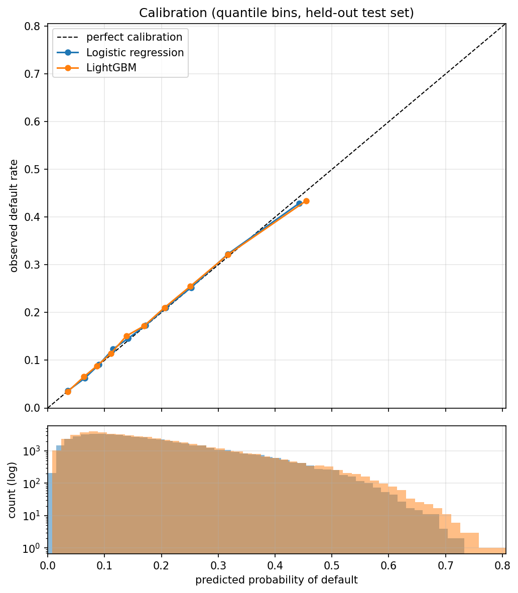
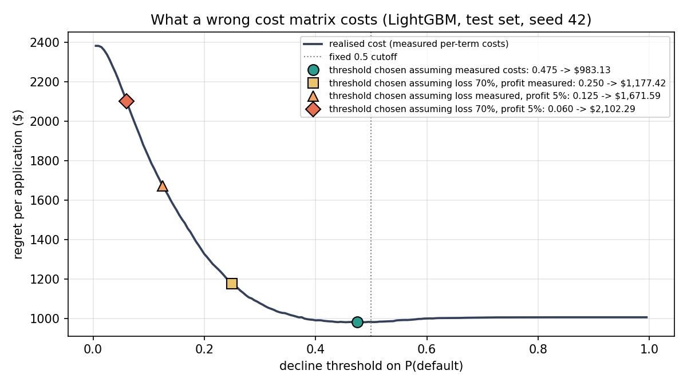

# Results

Generated by `scripts/run_full_analysis.py`. Do not edit by hand.
Primary seed 42; section 9 repeats the key numbers across 5 seed(s).

## 1. Dataset and censoring

2014 vintage: 235,629 loans; 223,103 with an observed outcome; default rate 0.1845.

Right-censoring bounds. The observed rate uses resolved loans only; the bounds
assume every unresolved loan eventually repays, or eventually defaults.

| term | loans | unresolved | pct_unresolved | observed_default_rate | if_all_unresolved_repay | if_all_unresolved_default |
| --- | --- | --- | --- | --- | --- | --- |
| 36 months | 162,570 | 0 | 0.0 | 13.7 | 13.7 | 13.7 |
| 60 months | 73,059 | 12,526 | 17.1 | 31.1 | 25.8 | 42.9 |

Unresolved 60-month loans are mostly `Current` -- on schedule several years in -- so
the true 60-month rate is very likely below the observed figure, toward the lower
bound. This is reasoning about who is censored, not a proof.

Matured vs resolved: months from issue to last recorded payment, 60-month loans.
(For charged-off loans the charge-off itself comes some months after this date.)

- resolved before month 60: 97.2%
- median months to last payment: 25

## 2. Missingness as signal

Computed on all labelled loans, for DESCRIPTION only. Not used to choose features:
every column below gets an indicator, so outcome information never shapes the
feature set. Note the sign flip -- missing delinquency history means good news,
missing employment length means bad news.

| column | n_missing | default_if_missing | default_if_present | lift_pp | p_value |
| --- | --- | --- | --- | --- | --- |
| `emp_length` | 11,554 | 23.7 | 18.2 | +5.56 | 7.9e-51 |
| `mths_since_recent_inq` | 20,185 | 13.7 | 18.9 | -5.18 | 5.7e-73 |
| `bc_util` | 2,482 | 20.2 | 18.4 | +1.76 | 2.7e-02 |
| `revol_util` | 115 | 20.0 | 18.4 | +1.55 | 7.6e-01 |
| `mths_since_last_major_derog` | 159,591 | 18.1 | 19.4 | -1.33 | 2.4e-13 |
| `mths_since_last_record` | 183,144 | 18.2 | 19.5 | -1.31 | 1.1e-09 |
| `mths_since_recent_bc_dlq` | 163,991 | 18.2 | 19.2 | -0.99 | 1.1e-07 |
| `mths_since_last_delinq` | 109,646 | 18.0 | 18.9 | -0.88 | 8.8e-08 |
| `mths_since_recent_revol_delinq` | 142,779 | 18.2 | 18.8 | -0.56 | 1.2e-03 |

## 3. Models and calibration

79 features. Test set: 55,776 loans (seed 42).

| model | test_auc | brier | mean_predicted | base_rate | max_bin_gap_pp | top_bin_gap_pp |
| --- | --- | --- | --- | --- | --- | --- |
| Logistic regression | 0.7173 | 0.1364 | 0.1838 | 0.1845 | 1.34 | +1.34 |
| LightGBM | 0.7206 | 0.1360 | 0.1832 | 0.1845 | 2.05 | +2.05 |

LightGBM reliability by quantile bin:

| bin | n | mean_predicted | observed_rate | gap |
| --- | --- | --- | --- | --- |
| 1 | 5,578 | 0.0349 | 0.0339 | +0.0011 |
| 2 | 5,578 | 0.0635 | 0.0653 | -0.0018 |
| 3 | 5,577 | 0.0864 | 0.0880 | -0.0016 |
| 4 | 5,578 | 0.1108 | 0.1137 | -0.0028 |
| 5 | 5,577 | 0.1384 | 0.1510 | -0.0126 |
| 6 | 5,578 | 0.1696 | 0.1719 | -0.0024 |
| 7 | 5,577 | 0.2054 | 0.2103 | -0.0049 |
| 8 | 5,578 | 0.2510 | 0.2551 | -0.0041 |
| 9 | 5,577 | 0.3173 | 0.3215 | -0.0042 |
| 10 | 5,578 | 0.4549 | 0.4344 | +0.0205 |

## 4. Measured costs

Realised investor cash flows, all labelled loans (descriptive):

| outcome | loans | mean_funded | mean_received | mean_net | net_pct_of_funded |
| --- | --- | --- | --- | --- | --- |
| Defaulted | 41,162 | $15,567.85 | $10,166.59 | −$5,401.26 | -34.8 |
| Fully paid | 181,941 | $14,354.15 | $17,250.25 | $2,896.10 | +19.1 |

Rates used for decisions, measured on TRAINING rows only, per term:

| term | loss_rate_L | profit_rate_G | ratio_L_over_G | bayes_threshold | train_loans |
| --- | --- | --- | --- | --- | --- |
| 36 months | 34.5 | 15.9 | 2.16 | 0.316 | 121,874 |
| 60 months | 35.2 | 29.6 | 1.19 | 0.457 | 45,453 |

Bayes threshold = G/(L+G): decline when the posterior exceeds it.

## 5. Decision performance (LightGBM, held-out test set)

Cost = regret against a perfect decision: funded defaults cost L x amount, declined
repayments cost G x amount, correct decisions cost zero.

| strategy | threshold | cost_per_application | decline_rate | approved_default_rate |
| --- | --- | --- | --- | --- |
| Decline everything | — | $2,381.91 | 100.0% | — |
| Fund everything | — | $1,006.05 | 0.0% | 18.5% |
| Fixed 0.5 cutoff | 0.500 | $982.17 | 2.4% | 17.6% |
| Fitted on IN-SAMPLE train predictions (wrong) | 0.375 | $1,006.29 | 9.0% | 15.9% |
| **Fitted out-of-fold, single** | **0.475** | $983.13 | 3.4% | 17.3% |
| **Fitted out-of-fold, per term** | **0.350 / 0.475** | $976.41 | 5.0% | 17.0% |
| *Test-fitted oracle (unattainable)* | *0.455* | $981.20 | 4.2% | 17.1% |

Model choice, priced in dollars: logistic regression with its own OOF-fitted
threshold (0.435) costs $983.03/app vs LightGBM $983.13/app,
LR minus LightGBM: −$0.10 per application. Section 9 shows
the spread of this difference across splits.

## 6. Sensitivity: what if the costs were assumed instead of measured?

Each row picks a threshold (out-of-fold) under an ASSUMED cost matrix, then scores
that policy on the test set with the MEASURED costs. The alternatives are
illustrative inputs for a stress test, not cited industry figures. Varying one
input at a time shows which assumption drives the damage.

| cost assumption used to CHOOSE the threshold | L / G (36mo) | chosen_threshold | decline_rate | true_cost_per_app | vs_measured |
| --- | --- | --- | --- | --- | --- |
| measured | 34% / 16% | 0.475 | 3.4% | $983.13 | 1.00x |
| loss 70%, profit measured | 70% / 16% | 0.250 | 25.0% | $1,177.42 | 1.20x |
| loss measured, profit 5% | 34% / 5% | 0.125 | 59.7% | $1,671.59 | 1.70x |
| loss 70%, profit 5% | 70% / 5% | 0.060 | 86.5% | $2,102.29 | 2.14x |

## 7. Theory vs practice: is the Bayes threshold recovered?

With calibrated posteriors the fitted threshold should sit near G/(L+G):

| term | bayes_G_over_L_plus_G | oof_fitted_threshold | gap |
| --- | --- | --- | --- |
| 36 months | 0.316 | 0.350 | +0.034 |
| 60 months | 0.457 | 0.475 | +0.018 |

Remaining gap: both error costs scale with amount funded, and larger loans default
more often, so the cost-weighted optimum shifts relative to the per-loan rule:

| amount_quintile | mean_funded | observed_default | mean_predicted |
| --- | --- | --- | --- |
| Q1 small | $4,797.97 | 0.141 | 0.142 |
| Q2 | $9,083.43 | 0.169 | 0.164 |
| Q3 | $13,100.88 | 0.196 | 0.199 |
| Q4 | $18,393.30 | 0.207 | 0.207 |
| Q5 large | $28,224.18 | 0.210 | 0.206 |

## 8. Segments (single OOF threshold)

By grade:

| segment | n | default_rate | mean_predicted | auc | decline_rate | cost_per_application |
| --- | --- | --- | --- | --- | --- | --- |
| A | 9,077 | 0.051 | 0.054 | 0.6411 | 0.0% | 246 |
| B | 14,958 | 0.120 | 0.112 | 0.6370 | 0.0% | 561 |
| C | 15,605 | 0.195 | 0.195 | 0.6319 | 0.3% | 993 |
| D | 9,850 | 0.274 | 0.272 | 0.6359 | 4.6% | 1,538 |
| E | 4,468 | 0.349 | 0.356 | 0.6342 | 17.6% | 2,068 |
| F | 1,451 | 0.378 | 0.396 | 0.6452 | 28.7% | 2,231 |
| G | 367 | 0.477 | 0.474 | 0.5525 | 49.9% | 2,943 |

By term:

| segment | n | default_rate | mean_predicted | auc | decline_rate | cost_per_application |
| --- | --- | --- | --- | --- | --- | --- |
| 36 | 40,696 | 0.138 | 0.137 | 0.6952 | 0.2% | 581 |
| 60 | 15,080 | 0.309 | 0.307 | 0.6541 | 11.9% | 2,069 |

By income quartile:

| segment | n | default_rate | mean_predicted | auc | decline_rate | cost_per_application |
| --- | --- | --- | --- | --- | --- | --- |
| Q1 low | 13,950 | 0.217 | 0.217 | 0.6910 | 4.6% | 717 |
| Q2 | 15,511 | 0.201 | 0.197 | 0.7145 | 4.7% | 1,005 |
| Q3 | 12,851 | 0.169 | 0.172 | 0.7323 | 2.9% | 1,063 |
| Q4 high | 13,464 | 0.146 | 0.143 | 0.7312 | 1.0% | 1,157 |

Within-grade AUC is far below overall AUC: most ranking power comes from
re-deriving LendingClub's own grade. Calibration holds inside every segment.

Per-segment thresholds, gain per application vs a single threshold:

| segment | apparent_gain_test_fitted | honest_gain_oof_fitted |
| --- | --- | --- |
| term | +$7.99 | +$6.72 |
| grade | +$5.10 | +$2.19 |
| purpose | +$6.76 | +$2.14 |

Apparent = thresholds fitted and scored on the test set (selects on noise).
Honest = fitted on out-of-fold training predictions, scored on test.

## 9. Robustness across train/test splits

Seeds: 42, 7, 123, 2024, 31337. Each seed is a different stratified split, with models, OOF
predictions, cost rates and thresholds all refitted.

| metric | mean | std | min | max |
| --- | --- | --- | --- | --- |
| auc_lr | 0.7188 | 0.0025 | 0.7154 | 0.7215 |
| auc_lgbm | 0.7222 | 0.0020 | 0.7198 | 0.7244 |
| threshold_oof | 0.465 | 0.018 | 0.445 | 0.480 |
| cost_fund_all | 1,002.56 | 2.77 | 999.16 | 1,006.05 |
| cost_at_0.5 | 978.97 | 3.40 | 973.53 | 982.17 |
| cost_oof_single | 975.15 | 6.17 | 970.07 | 983.13 |
| cost_oof_per_term | 969.60 | 5.74 | 963.65 | 976.41 |
| cost_lr_oof_single | 976.93 | 4.23 | 971.48 | 983.03 |
| lr_minus_lgbm_cost | +1.78 | +5.06 | -5.48 | +7.22 |
| gain_tuning_vs_0.5 | +3.82 | +4.57 | -0.96 | +9.12 |
| gain_per_term | +5.55 | +1.18 | +4.20 | +6.75 |
| gain_grade_thresholds | +1.95 | +2.20 | -1.50 | +4.50 |
| gain_purpose_thresholds | +1.20 | +3.74 | -2.77 | +6.86 |
| ratio_loss70 | 1.24 | 0.03 | 1.20 | 1.28 |
| ratio_profit5 | 1.72 | 0.02 | 1.70 | 1.75 |
| ratio_assumed_70_5 | 2.13 | 0.03 | 2.09 | 2.16 |

Gains are per application; positive = the refinement saved money on the test set.
A gain whose sign changes across seeds is not a finding.

LightGBM minus LR AUC per seed: +0.0032, +0.0041, +0.0033, +0.0021, +0.0044.
